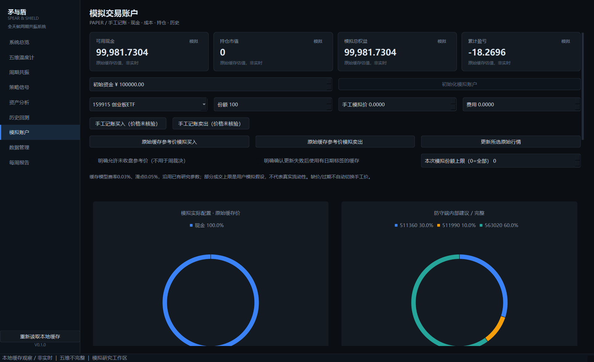
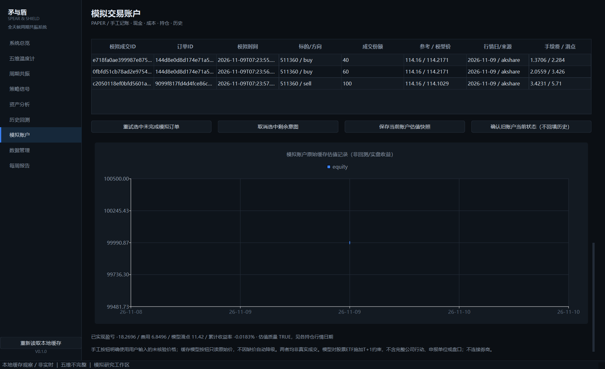
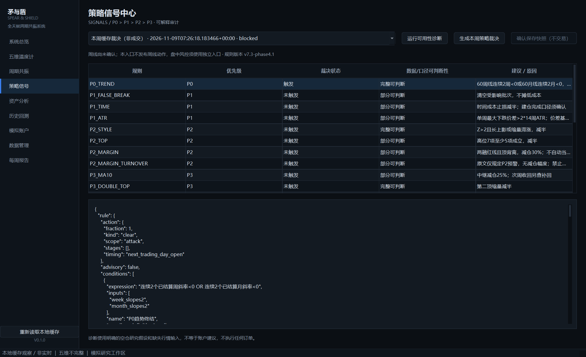
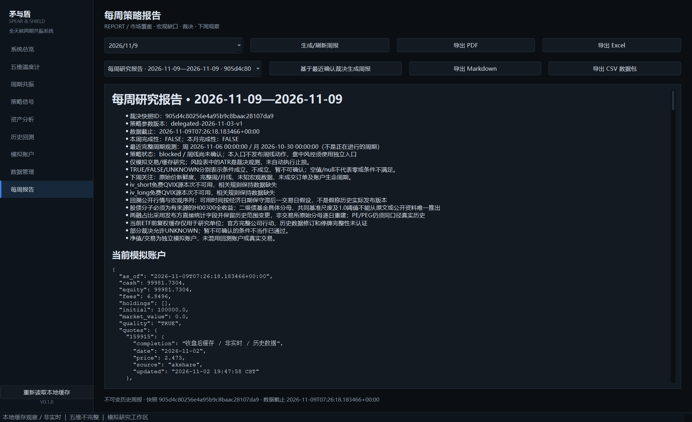
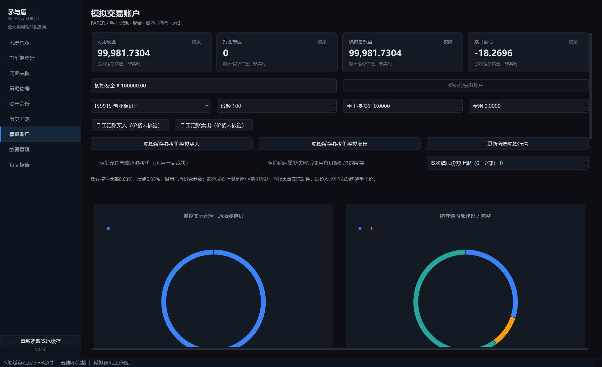

# 第三轮交付：模拟账户与每周策略执行闭环

日期：2026-11-09。状态：本轮实现与可重复测试完成，Windows原生窗口验证完成，等待人工验收；未提交、未推送。

## 实际交付

账户页支持初始化、原始缓存参考价模拟买卖、部分成交、重试、撤单、持仓/现金/成本/已实现盈亏、费用/滑点、资产曲线、独立订单和多笔回执。每笔回执关联行情来源/日期、模型时间、订单ID与账本ID。模拟和回测不共用账户状态。

策略信号页支持本周草稿→审阅→确认保存→历史查询。完整性与UNKNOWN明确列出；周报页绑定确认快照生成历史记录，支持Markdown、CSV数据包、Excel，并沿用已有PDF入口。没有自动下单或自动执行ATR止损。

数据库增量方案、业务状态流和日常操作见 [账户与每周闭环](../architecture/paper_weekly_workflow.md)。新增8表，无旧表改列、删表、重置或伪造历史回执；旧账户需明确确认可知起点。

## 本轮修改文件

以下相对于本轮开工时文件哈希清单，不把此前尚未提交的ATR/Dashboard工作计为本轮修改。

| 文件 | 本轮增量 |
|---|---|
| `src/spear_shield/portfolio/paper_execution.py`（新增） | 订单/多回执/审计/起点/估值/研究风险记录与独立缓存模型 |
| `src/spear_shield/services/weekly_workflow.py`（新增） | 缓存时点裁剪、日历/完成性、UNKNOWN账户适配、确认后不可覆盖快照 |
| `src/spear_shield/services/weekly_documents.py`（新增） | 已确认快照周报、历史查询、Markdown/CSV/Excel |
| `src/spear_shield/database/engine.py` | 注册增量表，重复初始化保留数据 |
| `src/spear_shield/portfolio/paper_account.py` | 原账本返回trade_id、允许明确模型记账时点、保存新账户起点、持仓来源/价格 |
| `src/spear_shield/ui/controller.py` | 加载新历史、合并已确认裁决、原始估值时点校验 |
| `src/spear_shield/ui/pages/account.py` | 模拟交易、许可、部分成交/重试/撤单、订单/回执/曲线和费用等 |
| `src/spear_shield/ui/pages/signal_center.py` | 草稿/确认按钮、历史快照上下文、UNKNOWN和建议展示 |
| `src/spear_shield/ui/pages/thermometer.py` | 五维数据日期、可计算性与完整策略可判断性区分 |
| `src/spear_shield/ui/pages/weekly_report.py` | 历史周报选择、基于确认裁决生成、Markdown/CSV及原导出复用 |
| `tests/unit/test_paper_execution.py`（新增） | 13项：金融账实、异常、持久化、幂等、数据许可与边界 |
| `tests/unit/test_weekly_workflow.py`（新增） | 3项：周期未完成、UNKNOWN、不可变快照/报告/导出、时点与独立ID |
| `tests/integration/test_weekly_closed_loop.py`（新增） | 2项：真实GUI控件交易与确认/报告闭环（隔离测试行情，明确合成样本） |
| `scripts/validate_round3_desktop.py`（新增） | 隔离真实缓存、真实抓取、原生窗口模拟交易/快照/导出/重启演练 |
| `docs/architecture/paper_weekly_workflow.md`（新增） | 模型、增量方案、时点及操作说明 |
| `docs/development/progress_round3.md`、本文件、`usability_round3_evidence.json`（新增） | 进度自查、实际结果与可校验指纹 |
| `.gitignore`、`README.md`、`CHANGELOG.md` | 本地周报忽略规则、入口、真实进度和边界 |
| `assets/usability-round3/*.png`（新增） | 原生窗口账户、订单/回执、裁决、周报、重开截图 |

未引入新依赖。运行环境Python3.12.4 / PySide6 6.8.1.1 / Windows。保留此前全部文件和用户修改；原策略资料未复制进新文档。

## 测试结果

串行可重复全量回归：**331 passed、0 failed、0 skipped，71.08秒**，11项第三方弃用告警。包含上一轮313项和本轮18项；没有删除、跳过或弱化原断言。

```powershell
D:\Anaconda\python.exe -m pytest -q --ignore=tests/integration/test_akshare_provider.py --basetemp=cache/usability-round3/pytest-final --junitxml=cache/usability-round3/final-tests.xml
```

三个既有外部网络集成测试另行各45秒限时：ETF历史 **1 passed**，两融 **1 passed**，创业板指数接口 **超时**。因此总计333项通过、1项外部网络检查超时，**不宣称包含该超时检查的所有测试全部通过**。当前代码未改行情引擎，超时事实保留；不会覆盖已有行情为假数据。原始511360另实际抓取447行成功，511990当次抓取失败后明确选择核心池内另一T+0标的511360作演练，不替换策略资产。

日志/机器证据：`cache/usability-round3/final-tests.xml`、`network-tests.json`、`desktop/real_fetch.json`、`desktop/gui_evidence.json`；可分享摘要见 [usability_round3_evidence.json](usability_round3_evidence.json)。

覆盖初始资金、买卖、费用/滑点、部分成交、重复请求、取消幂等、资金不足/超卖、T+1、未来/缺失/过期/失败更新、回执写失败事务回滚、旧库/重启、账实一致、未完成周线、UNKNOWN、裁决/报告不可变及导出。既有ATR旧目标失效、跨周/重启幂等、新目标独立ID和旧安全复现仍在331项中通过。

开发过程中新增接口曾发生参数不匹配，修复后重跑通过；首次原生验证脚本在确认前/后风险观察记录比较时点不一致，未把它当成资金不一致，也未修改业务或删除审计来过关。修正同一比较时点后，复用已有账户只读验证重开，没有重新买卖或重置资金。首次失败记录保存在 `gui_evidence_initial_failure.json`。

## Windows真实模拟交易证据

隔离目录 `D:\spear-shield\cache\usability-round3\desktop`，从上一轮真实缓存用SQLite backup取得副本，再联网更新511360原始价。正式用户账户未重置。以下是**参考缓存价格的模拟成交**，不是市场可执行报价或真实交易。

参考：511360短融ETF，AkShare原始行情，2026-11-09，价格114.16，写入15:19:42（上海时间），未完成日线，演练明确勾选允许未收盘参考价。

| 模拟步骤 | 份额 | 模型价格 | 费用 | 滑点成本 |
|---|---:|---:|---:|---:|
| 买入订单第一次部分成交 | 40 | 114.2171 | 1.3706 | 2.2840 |
| 同订单重试剩余成交 | 60 | 114.2171 | 2.0559 | 3.4260 |
| 独立卖出订单全部成交 | 100 | 114.1029 | 3.4231 | 5.7100 |

买入订单 `144d8e0d8d174e71a588489b55c46568`；卖出订单 `9099f817fd4d4fce86c232ceb92c1383`。每笔独立回执与账本ID详见机器证据。

初始100000；最终现金=净值 **99981.7304**，剩余持仓0，已实现盈亏 **-18.2696**，费用合计 **6.8496**，滑点合计 **11.42**。减少额=费用+滑点，账本、回执与净值一致，没有生成策略历史收益。

关闭MainWindow/数据库后重新建立窗口、连接与控制器：账户、现金、持仓、逐笔账本、订单、多回执、审计、资产记录、历史快照及报告ID一致。随后又独立启动标准模块入口并运行事件循环，退出码0；不是只做编译检查。











## 裁决与导出证据

最新确认快照 `905d4c80256e4a95b9c8baac28107da9`；另保留较早确认快照，历史可查询。当前为周一：周完成FALSE、月完成FALSE，保留上一完整周2026-11-06/月2026-10-30的观察；不把这些观察当作本周最终裁决。

29项条件UNKNOWN，完整策略未认证；裁决blocked，无自动订单，建议状态“暂不可确认”。原始缓存的缺失/旧日期明确展示；五维缺口和历史发布版本限制保留。

导出目录：`D:\spear-shield\releases\research-round3\905d4c80256e4a95b9c8baac28107da9`，包含：

- `weekly_report.md`：完整研究文本和表格。
- `weekly_report.xlsx`：真实写出Excel文件。
- `csv/`：market、macro、holdings、orders、fills、equity、unknown、risk、conditions九个CSV，加报告和快照身份哈希。订单2、成交3、资产记录4；未空造持仓或交易。

导出绑定确认快照内容哈希，不会在后续刷新时覆盖报告。各文件SHA256见机器证据。GUI旧PDF入口保留，其回归通过，本轮未把未检查排版的新PDF当作交付文件。

## 启动

开发环境正常启动（默认用户目录，不自动执行交易）：

```powershell
Set-Location D:\spear-shield
D:\Anaconda\python.exe -m spear_shield
```

查看本轮隔离验收账户/周报：

```powershell
D:\Anaconda\python.exe -m spear_shield --data-dir D:\spear-shield\cache\usability-round3\desktop
```

这是PySide6桌面软件，没有要访问的localhost网址。

## 自查与尚存限制

开工时已有文件哈希逐项比较：无文件丢失；策略、冻结参数、整个回测目录及原测试文件与开工基线一致；本轮已有代码仅修改7个账户/GUI/表注册文件。Dashboard、图表、指标及ATR模块没有本轮增量。`git diff --check`通过。

工作区 `main`，HEAD `5aa322defdbc7fa10f121a39acb92e3bb0950ddb` 不变。此前遗留大量未提交修改和新文件均保留，本轮新增也未暂存、未提交、未推送。未公开仓库、改写历史或删除原始资料。导出账户周报目录加入忽略，避免今后误提交个人研究记录。

剩余：外部指数源超时；QVIX/股债/部分基本面及实际历史发布时间缺口；缓存模型不含完整交易所撮合/公司行动，不能当作正式交易或实盘收益；手工账户生命周期不自动推测；本轮ATR仅观察、无自动模拟止损链；Windows安装包尚未生成。上述限制不阻断独立账户、部分研究快照和周报使用。

本轮停止于人工验收。后续可针对数据源稳定性、账户公司行动和更完整执行模型另行安排，不在本轮擅自改变策略或进入发布。
